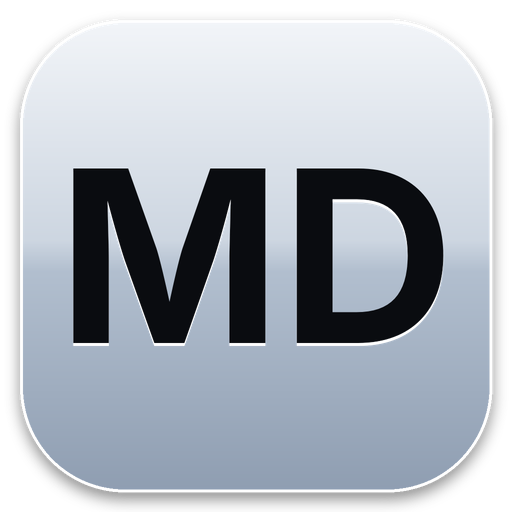
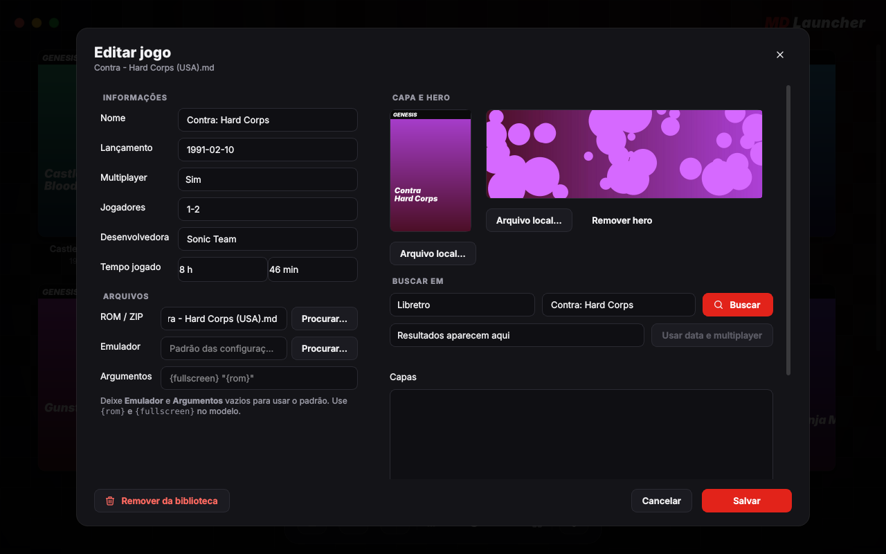

<p align="center">
  
</p>

<h1 align="center">MD Launcher</h1>

<p align="center">
  <b>🇺🇸 English</b> | <a href="README.pt-BR.md">🇧🇷 Português</a>
</p>

<p align="center">
  A launcher for your <b>Mega Drive / Genesis</b> collection, in the style of DuckStation, PCSX2 and RPCS3,<br>
  that works with <b>any emulator</b>. Built with <b>Tauri 2</b> (Rust + HTML).
</p>

<p align="center">
  <a href="https://github.com/leoblaidd/MDlauncher/releases/latest"><b>⬇ Download the latest version</b></a>
</p>


> The covers in the images above are examples. In real use, they come from SteamGridDB, IGDB or Libretro.

> The app's interface is in **Brazilian Portuguese**.

## Why it exists

Mega Drive emulators run really well, but none of them has a nice library with covers, play time and
info. MD Launcher is just that: a screen with your games' covers. You click, hit play and your
favorite emulator opens the game.

## Features

- **Clean interface, no title bar:** dark background with the subtle grid of Mega Drive boxes and a
  silver palette with bluish tones. Covers reach the edges of the window and pass under the logo and the dock.
- **Logo in a silver box** in the top-left corner: drag it to move the window, double-click to maximize.
- **Minimize, maximize and close buttons** in the Windows style, on the right, in a dark silver box.
- **Cover grid** with smooth scrolling and zoom adjustable with the dock's slider.
- **Game modal** with a Steam-style hero at the top, an overlapping cover, name, release date, multiplayer,
  developer and a **played-hours counter**.
- **Play + Fullscreen button:** the fullscreen button adds the right argument for your emulator (see the table).
- **Works with any emulator:** you pick the `.exe` and, if you want, the argument template.
- **ROM detection:** `.md`, `.gen`, `.smd`, `.bin`, `.68k`, `.sgd`, `.mdx` and `.zip` with the ROM inside. `.bin`
  files are checked for the `SEGA` header so they aren't confused with ROMs from other consoles.
- **Automatic covers, heroes and info:**
  1. **SteamGridDB:** cover (600×900 grid) and hero.
  2. **IGDB:** release date, multiplayer, number of players, developer and any missing art.
  3. **Libretro Thumbnails:** box art and title screen, no key needed (fallback).
- **Full editor:** name, date, multiplayer, players, developer, play time, ROM/ZIP path,
  emulator and game-specific arguments. For art, pick the source (SteamGridDB, IGDB or Libretro),
  search, see the options as thumbnails and click to set one. You can also use a local file.
- **Floating dock with a glass effect** (covers show blurred behind it): game search
  (`Ctrl+F`) · add a game manually · open the emulator without a game · open the ROM folder ·
  cover size · settings.
- **Context menu** on the grid (right click): play, edit, show in Explorer, fetch art again and remove.
- **First-run wizard:** emulator → ROM folder → API keys.
- **The window comes back the way it was** when you quit the game, maximized or not.
- **Installer** that asks where to install, plus a portable version.

| Game modal | Editing |
|---|---|
|  |  |

## Installation

1. Download `MDLauncher-2.0.0-Setup.exe` from the [Releases](https://github.com/leoblaidd/MDlauncher/releases/latest) page.
2. Run the installer and choose the install folder.
3. Open MD Launcher. The wizard asks for:
   - the **emulator's .exe**;
   - the **ROM folder**;
   - the **SteamGridDB key** (and, if you want, the IGDB credentials).

> There's also `MDLauncher-2.0.0-Portable.exe`, which runs without installing. It uses WebView2, which ships with
> Windows 10 and 11.

> Windows SmartScreen may warn that the app isn't recognized, because the executable has no digital
> signature. Click **More info → Run anyway**.

### API keys

| Source | What for | How to get it |
|---|---|---|
| SteamGridDB | Covers and heroes | Create an account at [steamgriddb.com](https://www.steamgriddb.com) and generate the key under **Preferences → API**. |
| IGDB (optional) | Date, multiplayer, developer and extra art | Register an app at [Twitch Developers](https://dev.twitch.tv/console/apps) and use the **Client ID** and **Client Secret** ([guide](https://api-docs.igdb.com/#account-creation)). |
| Libretro | Box art and title screen | No key needed. |

## Emulators and fullscreen

When you pick the `.exe`, the launcher recognizes the emulators below and fills in the argument template and the
fullscreen argument for you:

| Emulator | Fullscreen | Suggested template | Note |
|---|---|---|---|
| RetroArch | `-f` | `-L "cores\genesis_plus_gx_libretro.dll" {fullscreen} "{rom}"` | Change the core if you use PicoDrive or BlastEm. |
| Kega Fusion | `-fullscreen` | `-gen -auto {fullscreen} "{rom}"` | In fullscreen, ESC closes the emulator. |
| BlastEm | `-f` | `{fullscreen} "{rom}"` | `-f` **toggles** the mode: if `blastem.cfg` is already set to fullscreen, it opens windowed. |
| ares | `--fullscreen` | `--system "Mega Drive" {fullscreen} "{rom}"` | |
| Mednafen | `-video.fs 1` | `{fullscreen} "{rom}"` | |
| Gens/GS | `--fs --quickexit` | `{fullscreen} "{rom}"` | `--quickexit` makes ESC close the emulator. |
| DGen | `-f` | `{fullscreen} "{rom}"` | |
| Others | *(you provide it)* | `{fullscreen} "{rom}"` | Any emulator that takes the ROM on the command line. |

`{rom}` becomes the file path and `{fullscreen}` becomes the fullscreen argument when the button is on.
Each game can have its own emulator and arguments in the edit screen.

If your emulator can't open `.zip` files, turn on **Extrair ROMs de .zip antes de abrir** (Extract ROMs from .zip before opening) in Settings.

### Updating from 1.x

2.0 uses the same data folder and the same format as 1.x, so your library, covers and play time
are still there. The new installer is different from the old one: after installing 2.0, uninstall "MD Launcher 1.x"
in **Windows Settings → Apps**. This doesn't delete your data.

## Where the data lives

`%APPDATA%\MDLauncher\`
- `settings.json`: settings
- `library.json`: library, play times and edits
- `cache\`: downloaded covers and heroes

## Running from source

You need [Rust](https://rustup.rs), Node.js and, on Windows, WebView2 (already included in the system).

```bash
npm install
npx tauri dev
```

### Building the executable

The [`build.yml`](.github/workflows/build.yml) workflow builds on Windows, creates the NSIS installer, tests the
executable (`--selftest`) and attaches the installer and the portable `.exe` to the release. It runs when a `v*` tag is
pushed, when a release is published, or manually (with the **publish** option).

On your machine:

```bash
npx tauri build
```

The installer ends up in `src-tauri/target/release/bundle/nsis/`.

## Structure

```
src/                interface (HTML, CSS and JavaScript, no build step)
  index.html        window, grid, dock, logo and buttons
  styles.css        look (grid background, silver with bluish tones, dock glass)
  app.js            grid, smooth scrolling, modals, wizard, search and menu
  icons.js          SVG icons
src-tauri/          Rust backend (Tauri 2)
  src/lib.rs        commands called by the interface
  src/storage.rs    settings and library (JSON)
  src/scanner.rs    Mega Drive ROM and .zip detection
  src/metadata.rs   SteamGridDB, IGDB and Libretro
  src/emulators.rs  command line, fullscreen and launching
  tauri.conf.json   window and installer
```

## ☕ Support

MD Launcher is free and will stay that way. If it helped you and you'd like to give something back, you can buy me a coffee on **[Ko-fi](https://ko-fi.com/leoblaidd)**. 💜

[](https://ko-fi.com/leoblaidd)

## Credits

- Art: [SteamGridDB](https://www.steamgriddb.com), [IGDB](https://www.igdb.com) and [Libretro Thumbnails](https://thumbnails.libretro.com).
- Built with [Tauri](https://tauri.app) (Rust + WebView2). Versions 1.x used Python and Qt (PySide6).
- Mega Drive and Sega are trademarks of SEGA. This project is not affiliated with SEGA and does not distribute ROMs: use copies
  of your own cartridges.
