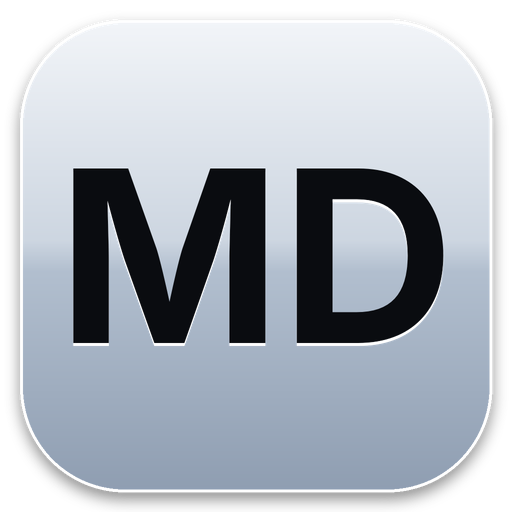
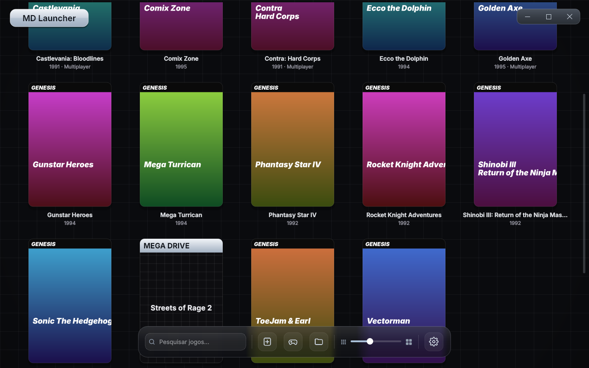
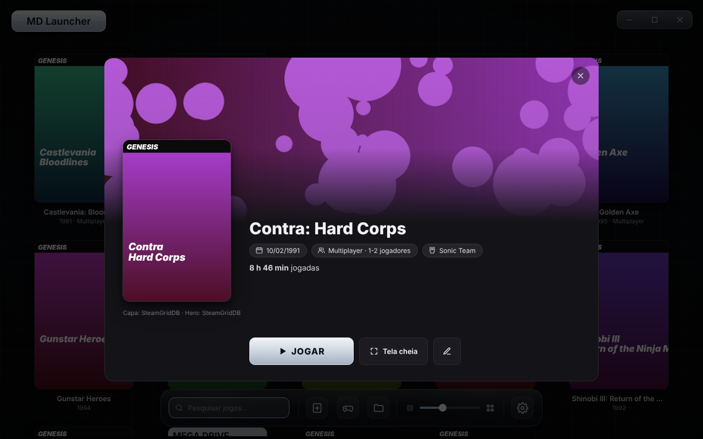
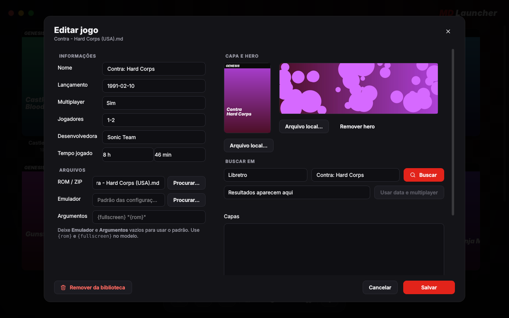

<p align="center">
  
</p>

<h1 align="center">MD Launcher</h1>

<p align="center">
  <a href="README.md">🇺🇸 English</a> | <b>🇧🇷 Português</b>
</p>

<p align="center">
  Launcher para a sua coleção de <b>Mega Drive / Genesis</b>, no estilo DuckStation, PCSX2 e RPCS3,<br>
  funcionando com <b>qualquer emulador</b>. Feito com <b>Tauri 2</b> (Rust + HTML).
</p>

<p align="center">
  <a href="https://github.com/leoblaidd/MDlauncher/releases/latest"><b>⬇ Baixar a última versão</b></a>
</p>



> As capas das imagens acima são de exemplo. No uso real, elas vêm do SteamGridDB, do IGDB ou do Libretro.

## Por que existe

Os emuladores de Mega Drive rodam muito bem, mas nenhum tem uma biblioteca bonita com capas, tempo de jogo e
informações. O MD Launcher é só isso: uma tela com as capas dos seus jogos. Você clica, dá play e o seu
emulador favorito abre o jogo.

## Recursos

- **Interface limpa, sem barra de título:** fundo escuro com a grade discreta das caixas de Mega Drive e
  paleta prata com tons azulados. As capas vão até as bordas da janela e passam por baixo do logo e do dock.
- **Logo em caixa prata** no canto superior esquerdo: arraste para mover a janela, dois cliques maximizam.
- **Botões minimizar, maximizar e fechar** no padrão do Windows, à direita, numa caixa prata escura.
- **Grid de capas** com rolagem suave e zoom ajustável pelo controle deslizante do dock.
- **Modal do jogo** com hero estilo Steam no topo, capa sobreposta, nome, data de lançamento, multiplayer,
  desenvolvedora e **contador de horas jogadas**.
- **Botão Jogar + Tela cheia:** o botão de tela cheia adiciona o argumento certo para o seu emulador (veja a tabela).
- **Funciona com qualquer emulador:** você escolhe o `.exe` e, se quiser, o modelo de argumentos.
- **Detecção de ROMs:** `.md`, `.gen`, `.smd`, `.bin`, `.68k`, `.sgd`, `.mdx` e `.zip` com a ROM dentro. Arquivos
  `.bin` são checados pelo cabeçalho `SEGA` para não confundir com ROMs de outros consoles.
- **Capas, heroes e informações automáticas:**
  1. **SteamGridDB:** capa (grid 600×900) e hero.
  2. **IGDB:** data de lançamento, multiplayer, número de jogadores, desenvolvedora e artes que faltarem.
  3. **Libretro Thumbnails:** box art e tela de título, sem precisar de chave (fallback).
- **Editor completo:** nome, data, multiplayer, jogadores, desenvolvedora, tempo jogado, caminho da ROM/ZIP,
  emulador e argumentos específicos do jogo. Para as artes, escolha a fonte (SteamGridDB, IGDB ou Libretro),
  busque, veja as opções em miniatura e clique para definir. Também dá para usar um arquivo local.
- **Dock flutuante com efeito de vidro** (as capas aparecem desfocadas por trás): pesquisa de jogos
  (`Ctrl+F`) · adicionar jogo manualmente · abrir o emulador sem jogo · abrir a pasta de ROMs ·
  tamanho das capas · configurações.
- **Menu de contexto** no grid (botão direito): jogar, editar, mostrar no Explorer, buscar artes de novo e remover.
- **Assistente de primeira execução:** emulador → pasta de ROMs → chaves de API.
- **Janela volta do jeito que estava** quando você sai do jogo, maximizada ou não.
- **Instalador** que pergunta onde instalar, além de uma versão portátil em `.zip`.

| Modal do jogo | Edição |
|---|---|
|  |  |

## Instalação

1. Baixe o `MDLauncher-2.0.0-Setup.exe` na página de [Releases](https://github.com/leoblaidd/MDlauncher/releases/latest).
2. Execute o instalador e escolha a pasta de instalação.
3. Abra o MD Launcher. O assistente pede:
   - o **.exe do emulador**;
   - a **pasta das ROMs**;
   - a **chave do SteamGridDB** (e, se quiser, as credenciais do IGDB).

> Também há o `MDLauncher-2.0.0-Portable.exe`, que roda sem instalar. Ele usa o WebView2, que já vem no
> Windows 10 e 11.

> O Windows SmartScreen pode avisar que o app não é reconhecido, porque o executável não tem assinatura
> digital. Clique em **Mais informações → Executar assim mesmo**.

### Chaves de API

| Fonte | Para quê | Como conseguir |
|---|---|---|
| SteamGridDB | Capas e heroes | Crie uma conta em [steamgriddb.com](https://www.steamgriddb.com) e gere a chave em **Preferences → API**. |
| IGDB (opcional) | Data, multiplayer, desenvolvedora e artes extras | Registre um app no [Twitch Developers](https://dev.twitch.tv/console/apps) e use o **Client ID** e o **Client Secret** ([guia](https://api-docs.igdb.com/#account-creation)). |
| Libretro | Box art e tela de título | Não precisa de chave. |

## Emuladores e tela cheia

Quando você escolhe o `.exe`, o launcher reconhece os emuladores abaixo e já preenche o modelo de argumentos e o
argumento de tela cheia:

| Emulador | Tela cheia | Modelo sugerido | Observação |
|---|---|---|---|
| RetroArch | `-f` | `-L "cores\genesis_plus_gx_libretro.dll" {fullscreen} "{rom}"` | Troque o core se usar PicoDrive ou BlastEm. |
| Kega Fusion | `-fullscreen` | `-gen -auto {fullscreen} "{rom}"` | Em tela cheia, ESC fecha o emulador. |
| BlastEm | `-f` | `{fullscreen} "{rom}"` | O `-f` **alterna** o modo: se o `blastem.cfg` já estiver em fullscreen, abre em janela. |
| ares | `--fullscreen` | `--system "Mega Drive" {fullscreen} "{rom}"` | |
| Mednafen | `-video.fs 1` | `{fullscreen} "{rom}"` | |
| Gens/GS | `--fs --quickexit` | `{fullscreen} "{rom}"` | `--quickexit` faz o ESC fechar o emulador. |
| DGen | `-f` | `{fullscreen} "{rom}"` | |
| Outros | *(você informa)* | `{fullscreen} "{rom}"` | Qualquer emulador que aceite a ROM pela linha de comando. |

`{rom}` vira o caminho do arquivo e `{fullscreen}` vira o argumento de tela cheia quando o botão estiver ligado.
Cada jogo pode ter emulador e argumentos próprios na tela de edição.

Se o seu emulador não abre `.zip`, ligue **Extrair ROMs de .zip antes de abrir** em Configurações.

### Atualizando da 1.x

A 2.0 usa a mesma pasta de dados e o mesmo formato da 1.x, então sua biblioteca, as capas e o tempo jogado
continuam lá. O instalador novo é diferente do antigo: depois de instalar a 2.0, desinstale o "MD Launcher 1.x"
em **Configurações do Windows → Aplicativos**. Isso não apaga seus dados.

## Onde ficam os dados

`%APPDATA%\MDLauncher\`
- `settings.json`: configurações
- `library.json`: biblioteca, tempos de jogo e edições
- `cache\`: capas e heroes baixados

## Rodar a partir do código

Precisa do [Rust](https://rustup.rs), do Node.js e, no Windows, do WebView2 (já vem no sistema).

```bash
npm install
npx tauri dev
```

### Gerar o executável

O workflow [`build.yml`](.github/workflows/build.yml) compila no Windows, gera o instalador NSIS, testa o
executável (`--selftest`) e anexa o instalador e o `.exe` portátil à release. Ele roda quando uma tag `v*` é
enviada, quando uma release é publicada ou manualmente (com a opção **publish**).

Na sua máquina:

```bash
npx tauri build
```

O instalador sai em `src-tauri/target/release/bundle/nsis/`.

## Estrutura

```
src/                interface (HTML, CSS e JavaScript, sem build)
  index.html        janela, grid, dock, logo e botões
  styles.css        visual (fundo com grade, prata com tons azulados, vidro do dock)
  app.js            grid, rolagem suave, modais, assistente, busca e menu
  icons.js          ícones SVG
src-tauri/          backend em Rust (Tauri 2)
  src/lib.rs        comandos chamados pela interface
  src/storage.rs    configurações e biblioteca (JSON)
  src/scanner.rs    identificação de ROMs de Mega Drive e .zip
  src/metadata.rs   SteamGridDB, IGDB e Libretro
  src/emulators.rs  linha de comando, tela cheia e execução
  tauri.conf.json   janela e instalador
```

## ☕ Apoie

O MD Launcher é gratuito e vai continuar sendo. Se ele te ajudou e você quiser dar uma força, dá pra me pagar um café no **[Ko-fi](https://ko-fi.com/leoblaidd)**. 💜

[](https://ko-fi.com/leoblaidd)

## Créditos

- Artes: [SteamGridDB](https://www.steamgriddb.com), [IGDB](https://www.igdb.com) e [Libretro Thumbnails](https://thumbnails.libretro.com).
- Feito com [Tauri](https://tauri.app) (Rust + WebView2). As versões 1.x usavam Python e Qt (PySide6).
- Mega Drive e Sega são marcas da SEGA. Este projeto não tem ligação com a SEGA e não distribui ROMs: use as cópias
  dos seus próprios cartuchos.
